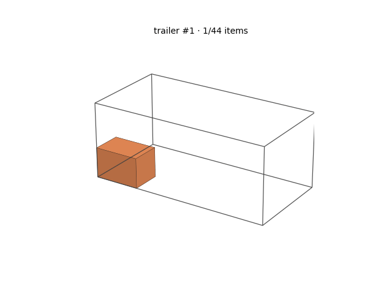
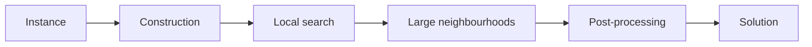
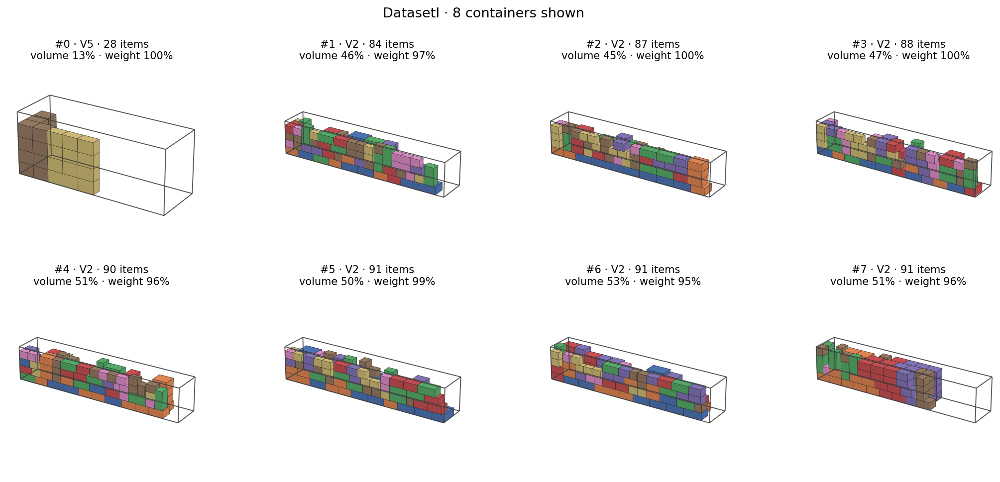
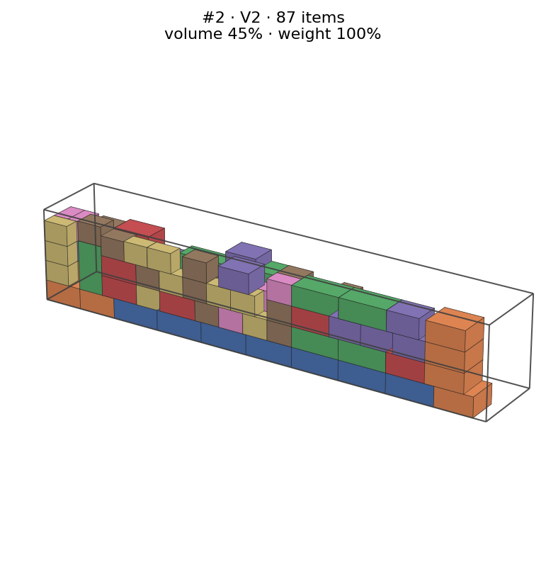
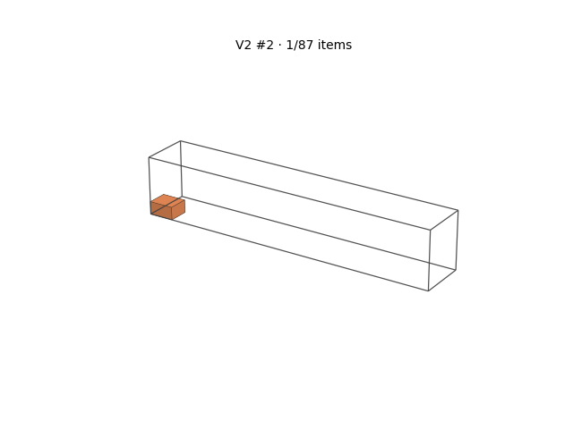
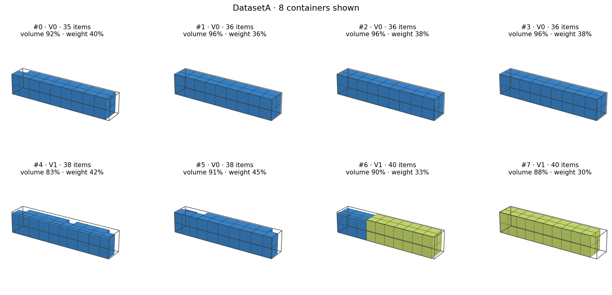
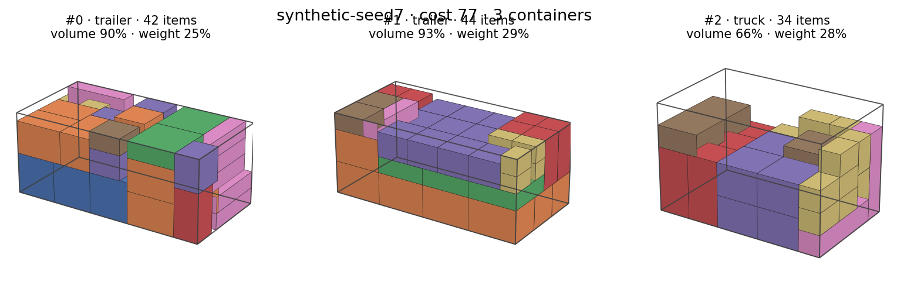

# Heterogeneous 3D Bin Packing: extreme points, local search and ALNS  

<p align="center">
  
</p>

A heuristic solver for three-dimensional bin packing with **heterogeneous containers**, weight and value limits, allowed rotations and a **stability constraint**, developed as a three-person group project for the *Operations Research* course at Politecnico di Torino (February to June 2026). It was evaluated on 20 public instances with 50 to 2,000 items and on hidden instances, with a limit of 10 minutes per instance.

> **About this repository.** The competition solver is kept in the team's private repository and is **not published here**. This repository describes its approach and reports its overall results. It also contains a small **clean-room demo**, written from scratch for this showcase, that implements a simplified version of the same ideas. **The demo shares no code with the competition solver.**

**Contents:** [Problem](#the-problem) · [Competition solver](#how-the-competition-solver-works) · [Engineering](#engineering) · [Results](#results) · [Demo](#run-the-demo) · [Benchmark](#benchmark) · [Team](#team)

---

## The problem

There are several container types, with no limit on how many containers of each type can be used. Each container type has its own dimensions, maximum weight, optional maximum value, cost, and *gravity strength* $g$: the percentage of an item's base that must rest on something. The task is to choose which containers to use, and where and how to place every item, so that the **total cost of the containers used** is minimal.

| A container type has | An item has |
|---|---|
| width, depth, height | width, depth, height |
| maximum weight, maximum value (optional) | weight, value |
| cost | allowed orientations (a subset of 6 axis-aligned rotations) |
| gravity strength $g$ (%) | |

Every item is assigned to exactly one container $k(i)$, with an orientation $o_i \in O_i$, an origin $(x_i, y_i, z_i)$ and resulting extents $(\ell_i, w_i, h_i)$ along the container axes (depth, width, height). With $\tau(k)$ the type of container $k$:

$$
\min \sum_{k \in K} c_{\tau(k)}
$$

subject to

- **containment:** $0 \le x_i$, $x_i + \ell_i \le D_{\tau(k(i))}$, and the same along $y$ (width $W$) and $z$ (height $H$);
- **no overlap:** two items in the same container are separated along at least one axis;
- **capacity:** $\sum_{i:\,k(i)=k} q_i \le Q_{\tau(k)}$ (weight) and $\sum_{i:\,k(i)=k} v_i \le V_{\tau(k)}$ (value);
- **stability:** an item with $z_i > 0$ must rest on the top faces of items ending exactly at height $z_i$, over at least $g_{\tau(k)}\%$ of its base:

$$
\sum_{j:\ k(j)=k(i),\ z_j + h_j = z_i} \bigl|F_i \cap F_j\bigr| \;\ge\; \frac{g_{\tau(k(i))}}{100}\,\ell_i\, w_i ,
$$

where $F_i$ is the footprint of item $i$ on the horizontal plane.

## How the competition solver works

The solver is written in Python and runs single-threaded, because the course rules did not allow parallel code.



1. **Construction.** Items are placed one by one at *extreme points*, the candidate positions generated by the corners of the boxes already placed (Crainic, Perboli and Tadei, 2008). Among the feasible positions the solver prefers those with the largest contact area with the floor, the walls and the neighbouring boxes. The construction is repeated with several item orderings and with a randomised (GRASP) variant.
2. **Local search.** Empty, merge or rebuild containers, with a perturbation when the search stalls. Only strictly better solutions are accepted.
3. **Large neighbourhoods.** Pool the items of a few containers and rebuild them from scratch into a cheaper combination of container types. On large instances an Adaptive Large Neighbourhood Search (ALNS) learns online which containers are worth rebuilding.
4. **Post-processing.** Each container is downgraded to the cheapest type that still holds its content.

Every phase respects the time limit, and the random choices use fixed seeds.

## Engineering

### Experiment workflow

**One change, one experiment.** Every change to the solver was run as an experiment through a small command-line tool:
- `start` opens a dedicated Git branch `exp/NNNN-…` from the current best version;
- `sanity` runs the checks described below;
- `commit` commits only the solver file;
- `report` writes a Markdown report with the diff;
- `record` registers the outcome after a full benchmark run, and promotes the branch to the new best if it improves.

**The sanity check** has two steps.
1. **Integrity of the evaluation.** It compares the SHA-256 checksums of the protected files (feasibility checker, benchmark runner, instances) with a stored baseline. An experiment can therefore never "improve" by touching the evaluation.
2. **Feasibility.** It runs the solver on three smoke instances with a short budget and stops the change if any solution is infeasible.

**Ideas and tiers.** Ideas came from a catalogue organised in tiers of increasing complexity. The workflow moves to the next tier after three consecutive experiments without improvement.

**The log** records **41 experiments: 20 promoted, 20 rejected**, one left open. The rejected ones are documented as well. They include an exact CP-SAT model run alongside the heuristic, simulated-annealing and iterated-local-search acceptance, and inter-container swap moves; none of them beat the heuristic within the time limit.

### Compiling the hot loop with Numba

**The bottleneck.** Profiling showed one dominant loop: scoring every *(extreme point × orientation)* candidate in a container. That covers feasibility (bounds, overlaps, support area) and the contact-area score.

**The kernel.** That loop became a single sequential `@njit` function, with no `parallel` and no `fastmath`. It is called once per (container, item) on NumPy mirrors of the container state.

**Same decisions as Python.** The compiled function performs the same floating-point operations in the same order as the Python code. It was tested to take exactly the same decision as the original Python implementation, both on randomly generated container states and on every placement call of real solver runs. The solver falls back to the Python path if Numba is not installed.

**Effect.** The kernel does not change what a given search does. It changes how much search fits in the time budget. In the team's benchmark runs, the total cost over the 20 public instances went from 313,598 to 312,095 (about −0.5%), with no instance getting worse.

The demo in this repository uses the same design, so its speed-up can be measured: see [Benchmark](#benchmark).

## Results

On the 20 public instances (10,759 items in total), the competition solver's solutions use **1,547 containers**, for a **total cost of 312,093.19**. **All 20 solutions are feasible** according to both the course's official checker and the independent checker of this repository (`python render_solution.py summary <datasets> <results>`).

The 312,093.19 is the exact sum. The 312,095 quoted in the Engineering section is the team's benchmark figure, which adds up per-instance costs rounded to whole numbers.

### What the solutions look like

The drawings below were produced by `render_solution.py` from the competition solver's solution files. Each title shows how much of the container's **volume** and **weight** capacity is used. A container can therefore be full even when it looks half empty, if weight is the limiting resource.

**DatasetI: limited by weight.** The first 8 containers of the solution. The trucks shown use only 45–53% of their volume, but 95–100% of their weight capacity. Each truck reaches its weight limit first, so no further box can be added, however much space is still free.

<p align="center">
  
</p>

<p align="center">
  
  
</p>

**DatasetA: limited by volume.** The first 8 containers of the solution: the opposite case. The containers shown are 83–96% full by volume, and use only 30–45% of their weight capacity. Colours mark item sizes, and most containers here hold rows of identically sized boxes.

<p align="center">
  
</p>

The instances and the official checker belong to the course and are not redistributed here. `render_solution.py` draws and checks any solution in the course CSV format, given a local copy of the instances.

## Run the demo

```bash
python -m venv .venv
source .venv/bin/activate          # Windows: .venv\Scripts\activate
pip install -r requirements.txt
python demo.py --gif --html
```

### The instance

`demo.py` generates a reproducible synthetic instance:
- 120 items from 8 box families, some of which may only be rotated around the vertical axis or must stay upright;
- 3 container types (van, truck, trailer) with stability requirements of 50%, 60% and 75%.

### The method

It is the same structure as above, deliberately small:
- **Construction.** First-fit over the open containers, best position inside a container chosen by the kernel (lowest point, then the largest contact area). Extreme points are the corners of the placed boxes, projected back along the other axes until they meet a wall or another box.
- **Local search.** Strict improvement only, with three moves:
  - *eliminate* empties the least-filled container into the others;
  - *downgrade* repacks a container into a cheaper type;
  - *repack* rebuilds the items of two sparse containers from scratch into a strictly cheaper set of containers.
- **Multi-start.** Three fixed item orderings plus randomised ones; the best solution is kept.

### Checks

- **Self-check.** Every solution is verified by an independent checker (`binpack/checker.py`, written separately from the packer). It covers bounds, overlaps, weight, value, orientations and stability.
- **Determinism.** The run is deterministic for a given `--seed`: same solution on any machine, with or without Numba.

Output of `python demo.py --gif --html` (the 6 randomised orderings are omitted, since they give the same numbers):

```
Instance synthetic-seed7: 120 items, 3 container types
  van      12x8x8  max weight 500  cost 10  stability 50%
  truck    16x10x10  max weight 1000  cost 17  stability 60%
  trailer  24x12x10  max weight 1800  cost 30  stability 75%
Kernel: Numba (compile / cache load 7.32 s)

ordering            constructive  after local search  containers
volume                        90                  77           3
base area                     90                  77           3
height                        90                  77           3
...

Best cost 77 with 3 containers (2x trailer, 1x truck); lower bound 65.7; search time 0.47 s
Self-check OK: 120 items, 3 containers, 0 violations (bounds, overlaps, weight, value, orientations, stability)
```

**How to read it.**
- **Construction.** It opens three trailers (cost 90), the type with the lowest cost per unit of volume.
- **Local search.** It replaces one trailer with a cheaper truck (cost 77).
- **Lower bound.** 65.7, computed by charging every unit of volume or weight at the cheapest rate among the container types.
- **Orderings.** On this instance every ordering reaches the same local optimum.

<p align="center">
  
</p>

The `--html` option also writes `assets/demo/packing.html`, which you can open in a browser. It is an interactive 3D view (plotly) with one view per container: you can rotate and zoom, and hovering on a box shows the item, its extents and its position. The page is generated locally and is not stored in the repository.

## Benchmark

```bash
python benchmark.py --end-to-end
```

The benchmark runs **the same kernel source** (`binpack/kernel.py`) interpreted by CPython and compiled by Numba, on identical inputs. It first checks that both return the same decision, then times them on containers holding 25, 100 and 250 boxes. The `--end-to-end` option also times a full constructive pass and verifies that both kernels produce the identical layout. Results and machine details are written to `benchmarks/results.md`.

Measured on Windows 11 with an Intel 64-bit CPU, using Python 3.12.7, NumPy 2.2.4 and Numba 0.65.1 (median of 5 repeats). The query is a 3×4×5 box with all 6 orientations, in a 40×40×40 container with 50% stability:

| boxes in container | candidate points | point × orientation pairs | Python per call | Numba per call | ratio |
|---:|---:|---:|---:|---:|---:|
| 25 | 67 | 402 | 25.52 ms | 40.7 µs | 627× |
| 100 | 272 | 1,632 | 262.96 ms | 691.8 µs | 380× |
| 250 | 703 | 4,218 | 1,295.80 ms | 3,448.5 µs | 376× |

**Full constructive pass** on the demo instance (120 items, volume order): Python 0.89 s, Numba 0.041 s, a **22×** speed-up, with an identical layout. The end-to-end ratio is lower than the per-call one because only the kernel is compiled. The rest of the pass (extreme-point updates and bookkeeping) runs in Python in both cases.

The interpreted baseline reads NumPy arrays element by element, which is a slow path for CPython. These ratios therefore measure this kernel in this setting; they are not a general claim about Python versus Numba.

## Repository layout

```
binpack/
  model.py      problem data, orientations, synthetic generator, course CSV I/O
  kernel.py     placement kernel (plain Python source, optionally compiled by Numba)
  packer.py     extreme points, construction, local search, multi-start
  checker.py    independent feasibility checker
  viz.py        matplotlib PNG/GIF and plotly 3D renderings
demo.py             run the demo end to end
benchmark.py        Python vs Numba on the same kernel
render_solution.py  check and draw solutions in the course CSV format
```

## Team

Competition solver: **Tudor Stefan Pascariu**, **Diego Catellani**, **Enrico Cirillo**, for the *Operations Research* (Ricerca Operativa) course, Politecnico di Torino, academic year 2025/26.

Tudor Stefan Pascariu wrote this showcase repository and the demo code. The problem statement, the instances and the official checker were provided by the course.

## License

The code in this repository is released under the [MIT License](LICENSE). The competition solver is not included.
